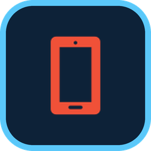

# iOS themes - hub themes for an iOS developer

Two themes in the layout of the hub's built-in Clean theme (the Geist font, Clean's radii and spacing, thin icons), with their own art and palette:

- **iOS · Liquid Glass** - light: a wallpaper of soft glass waves in the spirit of iOS 26, frosted glass panels, accent #007AFF.
- **iOS · Blueprint** - dark: an Interface Builder blueprint (grid, device outlines, sizes and margins), Swift-orange accent #F05138.

Icons - [Icons8](https://icons8.com) in the iOS style, session avatars - Icons8 iOS Filled (readable even at 16 px). The art is generated for the theme, with no logos or trademarks.

Pick one in "Settings" → "Look" → "Theme". The Clean layout is applied by the plugin's `clean.js` (needs a hub with the Clean theme, Plugin API 1.36+); without it the themes lie over "Classic".
